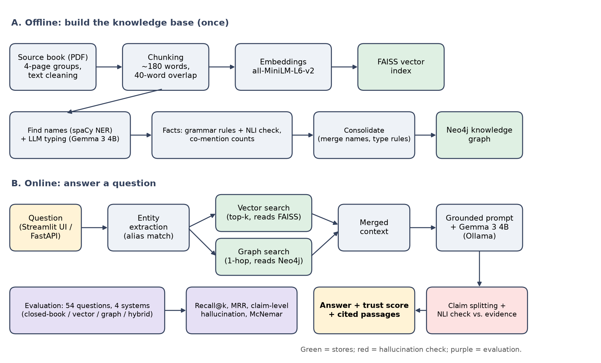

# HalluciNet — Final Report

## Hypothesis

> Combining graph-based and vector-based retrieval reduces hallucination
> on Indian historical Q&A compared to vector retrieval alone, measured on
> a curated 1857 Revolt test set.

## Scope

v1: the Revolt of 1857, answered from one source book: Christopher Hibbert,
*The Great Mutiny: India 1857* (1978). The book is cut into 4,147 chunks of
60 words (15-word overlap), and a knowledge graph of 245 entities and 441
relationships is built from the same text ([kg_build.md](kg_build.md)).
The schema is generic (`period_tag`, not 1857-specific fields), so more
books and periods can be added without a redesign.

## System

1. **Vector retrieval** (Part 2): book PDF → 4-page groups → 60-word chunks
   → `all-MiniLM-L6-v2` embeddings → FAISS index.
2. **Knowledge graph** (Parts 1, 3): names found with spaCy and typed by
   the local LLM; typed facts from grammar rules plus LLM drafts that were
   **checked by hand** (101 reviewed: 52 accepted, 12 corrected, 37
   rejected); co-mention
   edges for entities named together in 2+ sentences. Loaded into Neo4j.
   Every fact names its book page.
3. **Hybrid retrieval** (Part 4): entities in the question → up to 6 graph
   facts (1-hop facts and facts on paths between question entities, ranked
   by the question) + passages. Passages come from a pool of 20 candidates
   per source (vector search and graph-guided passages), limited to the
   book's narrative pages, reranked by a cross-encoder
   (`ms-marco-MiniLM-L-6-v2`), de-duplicated and widened by one chunk each
   side. The context is one numbered source list.
4. **Grounded generation** (Part 5): local Ollama (`gemma3:4b`) with a
   prompt that forbids outside knowledge, requires a fixed refusal when the
   sources don't answer, and asks for citations by source number (`[2]`).
5. **Trust scoring** (Part 6): the answer is split into claims; an
   independent NLI model (`cross-encoder/nli-MiniLM2-L6-H768`, not the
   generating LLM grading itself) checks each claim against the retrieved
   evidence, one sentence or sentence pair at a time. Trust score = share
   of claims supported.
6. **Evaluation** (Part 7): 54 questions written from the book
   independently of the system ([test_set.md](test_set.md)): 21 single-hop,
   13 temporal, 10 multi-hop, 10 unanswerable. Four systems: closed book
   (no retrieval), vector, graph, hybrid.
7. **App** (Part 8): FastAPI backend and a Streamlit front end (ask,
   compare modes side by side, browse the knowledge base), with a demo-answer
   cache as a fallback.

## Results

From [eval_report.md](eval_report.md): 1 run per system (closed book at
temperature 0.3, the retrieval systems at 0.1), 95% bootstrap confidence
intervals over questions in brackets.

**All 54 questions**

| system | correct | hallucinated answer | refused |
|---|---|---|---|
| closed book | 16.7% [7, 28] | 75.9% [65, 87] | 14.8% |
| vector | 83.3% [72, 93] | 13.0% [6, 22] | 18.5% |
| graph | 68.5% [56, 80] | 16.7% [7, 28] | 33.3% |
| hybrid | **85.2%** [76, 94] | 13.0% [6, 22] | 16.7% |

**44 answerable questions**

| system | correct | claim-level hallucination rate | trust score | citation accuracy |
|---|---|---|---|---|
| closed book | 11.4% | 77.5% | n/a | n/a |
| vector | 84.1% | 30.6% | 0.60 | 62.8% |
| graph | 61.4% | 27.0% | 0.72 | 51.1% |
| hybrid | **86.4%** | **23.6%** | 0.69 | **66.2%** |

**By question type (correct)**

| system | single-hop | multi-hop | temporal | unanswerable (refused) |
|---|---|---|---|---|
| closed book | 4.8% | 20% | 15.4% | 40% |
| vector | 81.0% | 90% | 84.6% | 80% |
| graph | 42.9% | 90% | 69.2% | **100%** |
| hybrid | 81.0% | **100%** | 84.6% | 80% |

**Paired comparison (exact McNemar)**

| A vs B | only A right | only B right | p |
|---|---|---|---|
| hybrid vs vector | 1 | 0 | 1.000 |
| hybrid vs graph | 11 | 2 | 0.022 |
| graph vs vector | 3 | 11 | 0.057 |
| hybrid vs closed book | 39 | 2 | <0.001 |

**Retrieval (answerable questions, top 5)**: the right page was retrieved
for 86% of questions with vector search, 91% with hybrid and 73% with
graph-only. Vector search puts it first for 80% of questions (hit@1 0.795,
MRR 0.83). Hybrid and graph-only MRR (0.52, 0.33) are lower because graph
facts are listed before passages and many facts have no gold page, so their
MRR is not comparable to vector's.

### How the results changed

Correct answers on the 44 answerable questions, per version:

| version | vector | graph | hybrid |
|---|---|---|---|
| first graph built from the book (3 runs) | 61.4% | 6.8% | 65.9% |
| + typed facts reviewed by hand, junk names cleaned | 54.5% | 54.5% | 59.1% |
| + numbered citations, reranker, narrative-page filter (current) | **84.1%** | **61.4%** | **86.4%** |

The hand review made graph-only usable (6.8% → 54.5%). The reranker made
the biggest single difference: vector hit@1 rose from 0.50 without it to
0.80 with it (same narrative-page filter), and answer accuracy followed. One cost: the
hybrid system's refusals on unanswerable questions fell from 10/10 to 8/10.

## Reading the results honestly

**What the numbers support:**

- **Retrieval sharply reduces hallucination.** Hallucinated answers fall
  from 76% (closed book) to 13% (vector, hybrid); 39 questions are answered
  correctly by hybrid and not by the closed-book model, against 2 the other
  way.
- **Hybrid is better than graph-only** (p = 0.022), mainly on single-hop
  questions, where the answer is usually in a passage, not a typed fact.
- **The graph helps on multi-hop questions and on refusing.** Hybrid got
  all 10 multi-hop questions right (vector 9), and graph-only refused all
  10 unanswerable questions. Graph-only answers also have the highest trust
  score (0.72).
- **Hybrid has the lowest claim-level hallucination rate** (23.6% vs 30.6%
  for vector) and the best citation accuracy, but the confidence intervals
  overlap, so this is a direction, not a proven difference.

**What they don't support:**

- **The hypothesis is not confirmed on this set.** Hybrid and vector are
  level on correctness (86.4% vs 84.1%; one question apart, p = 1.0). Once
  the reranker made the book passages good, the graph added little that the
  passages did not already contain. With 54 questions, only a large
  difference could be detected.

**Caveats:**

- **Not a held-out test set.** The same 54 questions were used to compare
  all three versions and to choose the later changes (reranker, page filter,
  prompt rules, name cleanup; some aliases were added because questions use
  them). The numbers are development-set results and likely optimistic; a
  fresh set of questions, written and scored once, is needed for an unbiased
  estimate.
- **One run.** The ± values in eval_report.md are 0 because only one run was
  made; `rag_eval.py generate --runs 3` gives run-to-run spread.
- **The automatic scorer is conservative.** It counts an answer as correct
  if it contains at least half the expected names or words. Two annotators
  checked it on 60 answers from the first book-graph run ([eval_annotation.md](eval_annotation.md)):
  they agreed with each other at kappa 0.86 and with the scorer at kappa
  0.77, and judged more retrieval answers correct than the scorer did. Read
  the RAG numbers as a lower bound.
- **Citation accuracy is a lower bound too.** A citation to a relevant
  source on a page other than the gold pages, or to a graph fact without a
  page, counts as wrong.
- **The graph is small and partly automatic.** 103 typed relationships;
  the remaining 338 edges only say two entities are mentioned together
  (see kg_build.md for why automatic extraction with a 4B model failed).
- **Known failure:** for "Who led the resistance at Jhansi?" the reranker
  ranks a passage about Captain Gordon's "gallant resistance" first, and
  the answer names him. The trust check flags that claim (0% support).

## What went right in the process

Building and testing against real output caught real bugs:

- The refusal phrase itself was being scored as an unsupported claim, and
  evidence passages were fed to the NLI model whole instead of sentence by
  sentence. Fixing both took the sample trust score from 21% to 61%: the
  21% was mostly a bug in the evaluation code, not a true hallucination rate.
- The first test set (30 questions) had been written from the knowledge
  graph and so favoured graph retrieval; it was replaced with 54 questions
  written from the book, with every gold page machine-checked.
- Reviewing the answers showed the model turning "mentioned together" edges
  into invented roles ("X was Y's ally"); those edges are now hidden from the
  model unless they connect two question entities, and the prompt forbids
  reading roles into them.

## Next steps

1. Run `rag_eval.py generate --runs 3` for run-to-run spread.
2. Look at the 2 unanswerable questions hybrid and vector answered anyway.
3. Grow the typed part of the graph (a larger model for drafting facts, or
   a longer hand review) and add harder multi-hop questions, where the graph
   is most likely to help.
4. Add the second source book, so the graph has to join facts across books.
5. Write a new held-out question set and score the final system on it once.

## History

The first version (Parts 1–8, August 2026) used 36 Wikipedia articles, a
hand-curated 47-entity graph and the 30-question set; its results are in
[part7_notes.md](part7_notes.md) and are superseded by the above.

## Repository

[github.com/yohannshroff/Hallucinet](https://github.com/yohannshroff/Hallucinet)
— see `README.md` for setup and the full pipeline.
